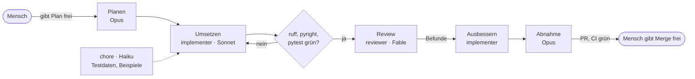

# ADR 0007: Arbeitsweise mit Agenten

Status: angenommen · Datum: 2026-10-31

## Kontext

Das Projekt entsteht an einem Wochenende, überwiegend mit KI-Agenten. Ein einzelner Agent, der plant,
umsetzt und sein eigenes Ergebnis prüft, übersieht Fehler, die er selbst eingebaut hat: Er misst gegen
seine eigenen Annahmen. Teure Modelle für jede Aufgabe kosten unnötig, billige Modelle für Planung und
Abnahme gefährden die Qualität. Und ohne festen Ablauf ist später nicht nachvollziehbar, wer was
entschieden hat und warum.

## Entscheidung

Jeder Plan-Schritt durchläuft sechs Phasen mit getrennten Rollen:

1. **Planen:** Die Hauptsession (Opus) schreibt den Plan nach `docs/plans/NN-<thema>.md`. Der Mensch gibt
   ihn frei.
2. **Umsetzen:** Der Subagent `implementer` (Sonnet) setzt genau einen Plan-Schritt um.
3. **Prüfen:** ruff, pyright und pytest müssen grün sein, bevor ein Review startet.
4. **Review:** Der Subagent `reviewer` (Fable) prüft unabhängig gegen Plan, ADRs und `CLAUDE.md` und schreibt
   die Befunde nach `docs/reviews/NN-<thema>.md`. Er ändert keinen Code.
5. **Ausbessern:** Der `implementer` arbeitet die Befunde ab und hakt sie in der Review-Datei ab.
6. **Abnahme:** Die Hauptsession (Opus) prüft gegen Plan und ADRs, öffnet den PR und merged per Squash,
   sobald der Mensch freigibt (ADR 0005).

Der Subagent `chore` (Haiku) erledigt nur Mechanisches: Testdaten, Beispieldateien, Doku-Formatierung und
Lint-Fixes.

Die Rollen sind unter `.claude/agents/` definiert. Dort stehen Modell, erlaubte Werkzeuge und Auftrag:

- Nur der `reviewer` hat kein `Edit` und schreibt allein seine Review-Datei.
- Kein Agent committet, pusht oder merged. Das macht die Hauptsession, gemergt wird nur mit Freigabe des
  Menschen.
- Entscheidungen, die fachlich oder für den Scope relevant sind, trifft der Mensch. Agenten schlagen vor.

## Konsequenzen

- Der Reviewer sieht nur den Code, den Plan und die Regeln, nicht die Überlegungen des Implementierers.
  Dadurch findet er Fehler, die der Autor übersehen hat. Ein Beispiel ist das Review zu Schritt 02
  (`docs/reviews/02-scaffold.md`): Die Hauptsession hatte die Action `setup-uv@v10` gesetzt, einen Tag, den es
  nicht gibt. Der Reviewer hat das als kritischen Befund gemeldet, bevor die CI gescheitert wäre.
- Jede Entscheidung bleibt als Datei im Repo nachvollziehbar: Plan, Review mit abgehakten Befunden und ADR.
  Der PR verlinkt alle drei.
- Die Modelle passen zur Aufgabe. Opus plant und nimmt ab, Sonnet setzt um, Fable reviewt, Haiku erledigt
  Mechanisches. Teure Modelle laufen nur dort, wo Urteilsvermögen gefragt ist.
- Pro Schritt kommt Aufwand dazu: ein Review-Durchlauf und eine Ausbesserungsrunde. Für einen Schritt, der
  nur Doku betrifft, kann der Review entfallen. Der PR nennt dann den Grund.
- Agenten arbeiten ohne Gedächtnis zwischen den Aufrufen. Was sie wissen müssen, steht in `CLAUDE.md`,
  `DOMAIN.md`, dem Plan und dem Auftrag der Hauptsession.
