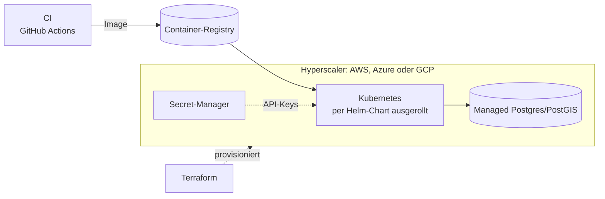

# Überblick

Dieses Repo ist eine Arbeitsprobe, entstanden an einem Wochenende. Es ist nicht für den Produktivbetrieb gedacht,
nicht einmal als Proof of Concept. Es zeigt einen **Grundstock, der skalieren könnte**: eine Codebasis mit klaren
Grenzen, Tests, CI und dokumentierten Entscheidungen, auf der sich weiterbauen ließe. Was das Projekt fachlich
tut, steht in [problem-statement.md](problem-statement.md). Fachlich ist es ein stark vereinfachtes Beispiel; echtes
Domänenwissen muss aufgebaut werden und entsteht nicht an einem Wochenende
([Einordnung](../DOMAIN.md#einordnung)). Setup und Befehle stehen in der [README](../README.md).

## Leitsätze

1. Bewährte Engineering-Prinzipien plus moderne KI-Ansätze ergeben eine Codebasis, die stabil und darauf
   ausgelegt ist, schnell zu skalieren. Beleg ist die Struktur, keine Messung.
2. Das Frontend ist pragmatisch und solide mit KI-Unterstützung gebaut, auch wenn es nicht die
   Hauptspezialisierung ist.
3. Als Allrounder deckt man DevOps-Aufgaben ab: zuverlässige Server-Infrastruktur und Build-Pipeline.

Die Abschnitte unten sagen jeweils, was im Repo vorhanden ist und wo es steht. Was nur ein Pfad ist, ist
ausdrücklich so benannt.

## Architektur

- Das LLM liest nur, Python rechnet und bewertet ([ADR 0001](adr/0001-ai-extracts-code-evaluates.md)).
  Der Extractor steckt hinter einem Protocol und ist austauschbar
  ([extractor.py](../src/carbon_preaudit/preaudit/extractor.py), [ADR 0008](adr/0008-gemini-as-default-extractor.md)).
- Die Rechenlogik besteht aus reinen Funktionen ohne I/O ([calc/](../src/carbon_preaudit/calc/),
  [compare.py](../src/carbon_preaudit/preaudit/compare.py)). Sie lässt sich ohne Server, Netz und Datenbank testen
  und später hinter anderen Schnittstellen wiederverwenden.
- Läufe sind reproduzierbar: gleiche Eingaben, Parameter- und Code-Version ergeben denselben Hash
  ([ADR 0002](adr/0002-reproducible-runs-via-hash.md), [hashing.py](../src/carbon_preaudit/calc/hashing.py)).
- Module, Datenfluss und Schritte: [Plan 01](plans/01-architecture.md).
- Ob das skaliert, ist hier nicht gemessen. Die Grenzen dafür sind gezogen: Der Webprozess speichert keine Ergebnisse,
  und die Persistenz ist ein eigenes Modul, das noch fehlt (Plan-Schritt 04, zurückgestellt).
  Wie ein Hyperscaler über Helm Charts und Terraform angebunden werden könnte, beschreibt
  [ADR 0009](adr/0009-operations-and-scaling-path.md).

## Python und Tooling

- Pakete und Struktur: ein uv-Projekt mit `src/`-Layout und einem Workspace-Mitglied für das Bump-Skript
  ([pyproject.toml](../pyproject.toml), [tools/](../tools/)). Abhängigkeiten sind per Lockfile fixiert
  ([uv.lock](../uv.lock)), Dependabot hält sie aktuell ([ADR 0004](adr/0004-dependabot-instead-of-snyk.md)).
- Syntax und Typen: Type Hints überall, pyright im Strict-Modus für `src`, `tools` und `evals`, Pydantic v2 für
  die Modelle ([models.py](../src/carbon_preaudit/domain/models.py)), eigene Exception-Klassen.
- Tests: pytest, kein Netzzugriff, die Extraktion läuft in Tests über `FakeExtractor`. Berechnungen haben
  Golden-Tests mit Handrechnung ([test_calc_golden.py](../tests/test_calc_golden.py)), der Hash hat eigene Tests
  ([test_hash.py](../tests/test_hash.py)).
- Evals: 12 Fälle mit eingebauten Fehlern, Precision und Recall je Feld
  ([evals/](../evals/), [Bericht](../evals/results/latest.md), Lauf vor den Audit-Korrekturen, Audit F-15).
- Automatische Prüfungen: pre-commit mit ruff, pyright, `uv lock` und commitlint
  ([.pre-commit-config.yaml](../.pre-commit-config.yaml)). commitlint läuft lokal beim Commit, in CI laufen die
  übrigen Hooks, und statt commitlint prüft dort `pr-title.yml` den PR-Titel.

## DevOps und Betrieb

Gebaut ist die Build-Pipeline bis zum geprüften Container. Die Server-Infrastruktur ist nur als Pfad in
[ADR 0009](adr/0009-operations-and-scaling-path.md) beschrieben.

Vorhanden:

- CI mit Checks, Versionsprüfung und Container-Build samt Smoke-Test auf `/health`
  ([ci.yml](../.github/workflows/ci.yml)), Prüfung des PR-Titels ([pr-title.yml](../.github/workflows/pr-title.yml)).
- Ein Dockerfile mit gepinntem Basis-Image, Layer-Caching für Abhängigkeiten und ohne Root-Rechte im Container
  ([Dockerfile](../Dockerfile)).
- Branch-Schutz per Ruleset, Squash-Merge und Conventional Commits ([ADR 0005](adr/0005-branches-and-squash-merge.md)).
- Versionen aus Git-Tags und ein manueller Release-Workflow, der Release-Notes erzeugt
  ([ADR 0006](adr/0006-versioning-via-git-tags.md), [release.yml](../.github/workflows/release.yml)).

Nur als Pfad beschrieben, nicht gebaut: Helm-Chart, Terraform, eine gehostete Datenbank (AWS, Azure oder GCP),
Secret-Manager, Image-Push in eine Registry und Observability. Das Release-Verfahren pusht heute kein Image.
Was das Repo dafür schon mitbringt und was fehlt, steht in
[ADR 0009](adr/0009-operations-and-scaling-path.md).

Zielbild, nicht umgesetzt:

## Frontend

Die Oberfläche ist serverseitig gerendert mit Jinja2 und HTMX, dazu Leaflet für die Karte. Es gibt keinen
Build-Schritt und kein JavaScript-Framework: eine kleine Skriptdatei ([app.js](../src/carbon_preaudit/web/static/app.js)),
ein Stylesheet und drei Templates ([templates/](../src/carbon_preaudit/web/templates/)). Die CDN-Skripte sind
auf Version gepinnt und per Integritäts-Hash gesichert ([index.html](../src/carbon_preaudit/web/templates/index.html)).
Das Markieren der Zitate im Text ist als Python-Funktion gebaut und getestet
([highlight.py](../src/carbon_preaudit/web/highlight.py), [test_highlight.py](../tests/test_highlight.py),
[test_web.py](../tests/test_web.py)). Eingabegrößen sind begrenzt, Eingabefehler werden als lesbare Meldung
angezeigt ([app.py](../src/carbon_preaudit/web/app.py)). Im Browser wurde es manuell mit echtem Gemini geprüft
([PR #10](https://github.com/kafe1012/carbon_preaudit/pull/10)). Dabei wurde eine leere Karte ab der zweiten
Prüfung gefunden und behoben (`htmx:afterSettle` in app.js). Automatisierte Browser-Tests gibt es nicht, und die
Darstellung der Fehlermeldungen ist nur über den TestClient geprüft (Audit F-11).

Das Frontend ist pragmatisch und bewusst schlicht: kein Build-Schritt, kein Framework. Es ist mit KI gebaut und
nicht die Hauptspezialisierung.

## AI-first und Clean Code

Das ganze Repo ist mit KI-Agenten entstanden, und genau daran lässt sich ablesen, wie sich saubere Struktur und
KI gegenseitig stützen: Kleine, reine Module, Typen und Tests geben den Agenten enge Leitplanken, und die Agenten
halten die Struktur in Plan, Review und Tests sauber.

- Feste Rollen und Ablauf Planen, Umsetzen, Prüfen, Review, Ausbessern: [ADR 0007](adr/0007-agent-workflow.md),
  Rollen in [.claude/agents/](../.claude/agents/), Regeln für alle in [CLAUDE.md](../CLAUDE.md).
- Jeder Schritt hat Plan, unabhängiges Review mit abgehakten Befunden und PR ([docs/reviews/](reviews/)).
- Ein nachträgliches Audit des gesamten Codes mit Findings, Entscheidungen und Korrekturen je Commit
  ([audit/summary.md](../audit/summary.md)).
- Die KI ist im Produkt selbst eng geführt: Sie extrahiert Werte mit wörtlichem Zitat, der Code prüft das Zitat,
  rechnet und bewertet ([ADR 0001](adr/0001-ai-extracts-code-evaluates.md)).

## Domäne

Das Projekt ist an einer echten Fachdomäne ausgerichtet, nicht an der Technik allein: Begriffe, Einheiten und
typische Fehler stehen in [DOMAIN.md](../DOMAIN.md), das Problem in [problem-statement.md](problem-statement.md).
Zur Einordnung und zu den Vereinfachungen siehe [DOMAIN.md](../DOMAIN.md#einordnung).

## Ownership

- Entscheidungen stehen mit Kontext, Begründung und Konsequenzen als ADR im Repo ([docs/adr/](adr/)), auch
  die, die etwas bewusst nicht tun ([ADR 0003](adr/0003-sqlite-instead-of-postgres.md),
  [ADR 0009](adr/0009-operations-and-scaling-path.md)).
- Fehler sind offen dokumentiert: das Audit nennt 33 Findings, davon sind drei nicht abgeschlossen, darunter
  F-32 (der Container-Start nach README liefert ohne API-Key keine Prüfung)
  ([audit/summary.md](../audit/summary.md)). Review-Befunde bleiben mit Lösung in [docs/reviews/](reviews/).
- Was fehlt, steht in der README unter [„Bewusst nicht enthalten“](../README.md#bewusst-nicht-enthalten).
- Entscheidungen zu Scope und Fachlichkeit trifft der Mensch, Agenten schlagen vor ([ADR 0007](adr/0007-agent-workflow.md)).
