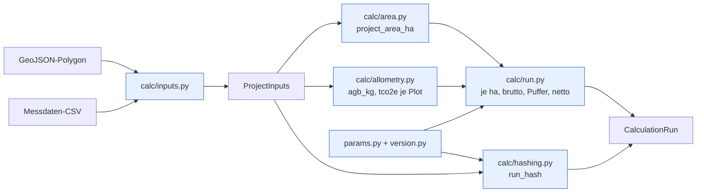
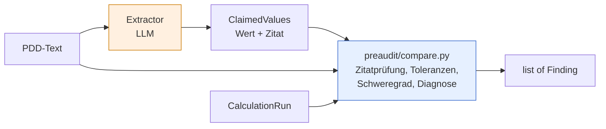

# Plan 01: Architektur

Status: freigegeben · Grundlage: `CLAUDE.md`, `DOMAIN.md`, ADR 0001–0003

## Ziel

Ein Pre-Audit-Check für ARR-Projekte: Ein Berechnungslauf ermittelt aus Polygon und Plot-Messdaten
die handelbaren tCO₂e. Ein Pre-Audit vergleicht die Zahlen eines PDD-Abschnitts damit und liefert
belegte Befunde. Das LLM extrahiert nur, bewertet wird deterministisch in Python (ADR 0001).

## Module

| Modul | Inhalt | I/O |
| --- | --- | --- |
| `domain/models.py` | Pydantic-Modelle (unten), `Severity`, `Diagnosis` | nein |
| `calc/params.py` | Alle fachlichen Konstanten und Toleranzen, `PARAMS_VERSION` | nein |
| `calc/version.py` | `CALC_VERSION` | nein |
| `calc/inputs.py` | GeoJSON- und CSV-**Strings** → `ProjectInputs`, Validierung, eigene Exceptions | nein |
| `calc/area.py` | `polygon_area_ha()` über `pyproj.Geod(ellps="WGS84").polygon_area_perimeter` | nein |
| `calc/allometry.py` | `agb_kg()`, `tco2e_from_agb_kg()` | nein |
| `calc/hashing.py` | Kanonisches JSON, `run_hash()` | nein |
| `calc/run.py` | `calculate(inputs: ProjectInputs) -> CalculationRun` | nein |
| `preaudit/extractor.py` | `Extractor` (Protocol), `AnthropicExtractor`, `FakeExtractor` | nur `AnthropicExtractor` |
| `preaudit/compare.py` | `compare(claimed, run, text) -> list[Finding]` | nein |
| `store/` | Persistenz der Läufe, SQLAlchemy 2 + SQLite (ADR 0003) | ja |
| `web/` | FastAPI, Jinja2 + HTMX, Leaflet | ja |
| `evals/` | Fälle, Runner, Scorer | ja |

### Konstanten in `calc/params.py`

| Name | Wert | Bedeutung |
| --- | --- | --- |
| `PARAMS_VERSION` | `"1"` | Version des Parametersatzes, geht in den Hash ein |
| `CHAVE_A` | `0.0673` | Chave et al. 2014, Vorfaktor |
| `CHAVE_B` | `0.976` | Chave et al. 2014, Exponent |
| `CARBON_FRACTION` | `0.47` | Kohlenstoffanteil der Trockenbiomasse |
| `CO2_PER_C` | `44 / 12` | Umrechnung C → CO₂ |
| `DEFAULT_WOOD_DENSITY_G_CM3` | `0.6` | Demo-Annahme, wenn `wood_density` fehlt |
| `MAX_WOOD_DENSITY_G_CM3` | `1.5` | Plausibilitätsgrenze: größere Werte sind fast sicher kg/m³ statt g/cm³, der Parser lehnt sie ab |
| `DEFAULT_BUFFER_PCT` | `20.0` | Pufferabzug in Prozent |
| `TOL_AREA_REL` | `0.01` | Toleranz Fläche, relativ |
| `TOL_TONNES_REL` | `0.02` | Toleranz Tonnen, relativ, auch für Diagnosen |
| `TOL_BUFFER_ABS` | `0.01` | Toleranz Puffer, absolut in Prozentpunkten |
| `EXPECTED_METHODOLOGY` | `"VM0047"` | Erwartete Methodologie |

## Domänenmodelle

Alle Modelle sind `frozen`. Die Einheit steht im Feldnamen.

**Eingaben**

| Modell | Feld | Typ | Einheit / Regel |
| --- | --- | --- | --- |
| `Tree` | `plot_id` | `str` | |
| | `tree_id` | `str` | eindeutig je Plot |
| | `dbh_cm` | `float` | cm, > 0 |
| | `height_m` | `float` | m, > 0 |
| | `wood_density_g_cm3` | `float \| None` | g/cm³, > 0; `None` → Default |
| `Plot` | `plot_id` | `str` | eindeutig |
| | `plot_area_m2` | `float` | m², > 0, in allen Zeilen eines Plots gleich |
| | `trees` | `tuple[Tree, ...]` | mindestens ein Baum |
| `ProjectInputs` | `polygon` | `GeoJSONPolygon` | WGS84, `type == "Polygon"`, Ringe geschlossen |
| | `plots` | `tuple[Plot, ...]` | mindestens ein Plot |
| | `buffer_pct` | `float` | Prozent, 0–100, Default `DEFAULT_BUFFER_PCT` |

**Ergebnis**

| Modell | Feld | Typ | Einheit |
| --- | --- | --- | --- |
| `PlotResult` | `plot_id` | `str` | |
| | `plot_area_ha` | `float` | ha |
| | `agb_kg` | `float` | kg |
| | `tco2e` | `float` | t CO₂e |
| `CalculationRun` | `run_hash` | `str` | SHA-256, hex |
| | `params_version`, `calc_version` | `str` | |
| | `project_area_ha` | `float` | ha |
| | `plot_count`, `tree_count` | `int` | |
| | `trees_with_default_density` | `int` | Bäume ohne Messwert für ρ |
| | `tco2e_per_ha` | `float` | t CO₂e/ha |
| | `tco2e_gross` | `float` | t CO₂e |
| | `buffer_pct` | `float` | % |
| | `tco2e_buffer` | `float` | t CO₂e |
| | `tco2e_net` | `float` | t CO₂e, handelbar |
| | `plots` | `tuple[PlotResult, ...]` | |

**Pre-Audit**

| Modell | Feld | Typ | Regel |
| --- | --- | --- | --- |
| `ClaimedValue[T]` | `value` | `T \| None` | wie im Text, nicht umgerechnet |
| | `quote` | `str \| None` | wörtliches Zitat; `value` und `quote` beide gesetzt oder beide `None` |
| `ClaimedValues` | `project_area_ha`, `tco2e_gross`, `tco2e_net`, `buffer_pct` | `ClaimedValue[float]` | |
| | `methodology` | `ClaimedValue[str]` | |
| `Severity` | | `StrEnum` | `critical` / `major` / `info` (UI: kritisch / wichtig / hinweis) |
| `Diagnosis` | | `StrEnum` | `tc_instead_of_tco2e` / `gross_net_swapped` |
| `Finding` | `field` | `Literal[...]` | eines der fünf Felder aus `ClaimedValues` |
| | `severity` | `Severity` | |
| | `claimed` | `float \| str \| None` | |
| | `computed` | `float \| str` | |
| | `quote` | `str \| None` | |
| | `deviation_rel` | `float \| None` | `(c − k) / k`, nur bei Zahlen |
| | `diagnosis` | `Diagnosis \| None` | |
| | `message` | `str` | deutscher Satz für die UI |

## Berechnungslauf

1. `agb_kg = CHAVE_A · (ρ · dbh_cm² · height_m) ^ CHAVE_B`. Fehlt ρ, gilt `DEFAULT_WOOD_DENSITY_G_CM3`, und der Baum wird in `trees_with_default_density` gezählt.
2. Je Plot: `tco2e = Σ agb_kg / 1000 · CARBON_FRACTION · CO2_PER_C`, `plot_area_ha = plot_area_m2 / 10 000`.
3. Flächengewichtet: `tco2e_per_ha = Σ tco2e (alle Plots) / Σ plot_area_ha (alle Plots)`.
4. `project_area_ha` geodätisch aus dem Polygon: Betrag der Außenringfläche minus Löcher.
5. `tco2e_gross = tco2e_per_ha · project_area_ha`
6. `tco2e_buffer = tco2e_gross · buffer_pct / 100`, `tco2e_net = tco2e_gross − tco2e_buffer`
7. `run_hash` über die kanonischen Eingaben, `PARAMS_VERSION` und `CALC_VERSION` (ADR 0002).

Intern wird nicht gerundet, gerundet wird erst in der Anzeige.

Beispiel zur Handrechnung (ein Baum, D = 20 cm, H = 15 m, ρ = 0,6, Plot 400 m²):
ρ·D²·H = 3600 → AGB = 0,0673 · 3600^0,976 ≈ 199,05 kg → 0,19905 t · 0,47 · 44/12 ≈ 0,3430 tCO₂e
→ 0,3430 / 0,04 ha ≈ 8,576 tCO₂e/ha.

## Pre-Audit

| Feld | Prüfung (c = behauptet, k = berechnet) | Abweichung | fehlt im Text |
| --- | --- | --- | --- |
| `tco2e_gross`, `tco2e_net` | `abs(c − k) / k ≤ TOL_TONNES_REL` | `critical` | `info` |
| `project_area_ha` | `abs(c − k) / k ≤ TOL_AREA_REL` | `major` | `info` |
| `buffer_pct` | `math.isclose(c, k, abs_tol=TOL_BUFFER_ABS)` | `major` | `info` |
| `methodology` | Leerzeichen und Bindestriche entfernen, Großschreibung, `VM\d{4}` suchen, mit `EXPECTED_METHODOLOGY` vergleichen. Kein Treffer zählt als Abweichung. | `major` | `info` |

Innerhalb der Toleranz entsteht kein Befund.

**Diagnosen** bei einer Abweichung der Tonnen, mit `TOL_TONNES_REL` relativ zum Vergleichswert:

- `c ≈ k / CO2_PER_C` → `tc_instead_of_tco2e` („vermutlich tC statt tCO₂e“)
- nur für `tco2e_net`: `c ≈ run.tco2e_gross` → `gross_net_swapped` („brutto/netto verwechselt“)

**Zitatprüfung:** `compare()` prüft, ob jedes `quote` wörtlich im Text steht. Leerzeichen werden normalisiert.
Steht es nicht im Text, wird der Wert nicht verglichen, und es entsteht ein `info`-Befund
„Zitat nicht im Text gefunden“. Damit sind halluzinierte Zitate abgefangen (Leitprinzip 3, ADR 0001).

**Extractor:** Der Prompt verlangt, Zahlen so zu übernehmen, wie sie im Text stehen. Der Extractor rechnet
nicht, rechnet keine Einheiten um und bewertet nicht. Das Modell kommt aus der Umgebungsvariable
`CARBON_PREAUDIT_MODEL`; den Default legt Schritt 05 fest. Die Ausgabe ist strukturiert und wird gegen
`ClaimedValues` validiert. Ungültige Ausgaben werfen `ExtractionError`.

Orange ist KI, Blau ist deterministischer Code.

## Umsetzungsschritte

Die Nummern entsprechen `WEEKEND-PLAN.md` und den Review-Dateien in `docs/reviews/`.

### 02 Projektgerüst

FastAPI-App in `web/app.py` mit `GET /health`, Dockerfile, GitHub Actions. Der Workflow führt
`uv run pre-commit run --all-files` und `uv run pytest` aus und prüft den PR-Titel auf Conventional Commits.
Der `chore`-Agent legt unter `examples/` ein GeoJSON-Polygon von ca. 100 ha in Costa Rica an, dazu eine CSV
mit 3 Plots à 400 m² und je 8–12 Bäumen.

**DoD:** CI grün auf GitHub, `/health` hat einen Test, `docker build` läuft durch. Die CI-Jobs sind im
Ruleset für `master` als Pflicht-Checks eingetragen (ADR 0005).

### 03 Berechnungslauf

`domain/models.py` (Eingabe- und Ergebnismodelle), `calc/*`.

**DoD:**
- Golden-Test mit Handrechnung für einen Baum und einen Plot, Sollwerte nach `CALC_VERSION` geführt (ADR 0002)
- Flächentest gegen ein Polygon mit bekannter Fläche
- Der Hash bleibt bei umsortierten CSV-Zeilen gleich und ändert sich bei anderem `buffer_pct`, `PARAMS_VERSION` oder `CALC_VERSION`.
- `trees_with_default_density` wird getestet.
- Eingabefehler (leerer Plot, widersprüchliche `plot_area_m2`, offenes Polygon, `MultiPolygon`) werfen eigene Exceptions.
- Lauf über `examples/` liefert plausible Werte.

### 04 Speicherung der Läufe

`store/` mit Tabelle `runs`: `run_hash` (Primärschlüssel), kanonische Eingaben, Ergebnis als JSON und
`created_at`. `created_at` geht nicht in den Hash ein. Speichern ist idempotent.

**DoD:** Roundtrip-Test gegen SQLite im Speicher, und doppeltes Speichern erzeugt keinen zweiten Eintrag.
Fällt laut Abbruchregel als Drittes weg.

### 05 Pre-Audit

`ClaimedValues`, `Finding`, `Severity`, `Diagnosis`, `preaudit/extractor.py`, `preaudit/compare.py`.

**DoD:** mindestens ein Test je Zeile der Regeltabelle (innerhalb, außerhalb, fehlt), beide Diagnosen,
Zitatprüfung, Methodologie-Normalisierung. In Tests kommt nur `FakeExtractor` vor.

### 06 Evals

Der `chore`-Agent legt 12 Fälle in `evals/cases/*.yaml` an: 3 fehlerfrei, 3 falsche Fläche, 2 falsche Tonnen,
2 falscher Puffer, 2 fehlender Wert. Runner und Scorer kommen nach `evals/`. Ein erwarteter Befund gilt als
getroffen, wenn `field` und `severity` stimmen. Precision und Recall werden je Feld berechnet, Diagnosen
separat ausgewiesen. Das Ergebnis geht nach `evals/results/latest.md`.

**DoD:** `uv run python -m evals` läuft durch, der Scorer hat Unit-Tests mit festen Befundlisten.

### 07 Oberfläche

`GET /` und `POST /check` (multipart: GeoJSON, CSV, PDD-Text). Links stehen die Leaflet-Karte und die
Kennzahlen (ha, tCO₂e brutto und netto, Puffer, gekürzter Hash). Rechts steht der PDD-Text mit farbig
markierten Zitaten, darunter die Befundliste. HTMX und Leaflet kommen per CDN mit gepinnter Version.

**DoD:** Ein TestClient-Test mit `FakeExtractor` rendert die Befunde, und es gibt keinen Build-Schritt.

## Offene Fragen

- Ob die Plots innerhalb des Polygons liegen oder sich überlappen, wird nicht geprüft. Die CSV hat keine
  Koordinaten, und ohne shapely gibt es keine Geometrie-Operationen. Kommt nach „Bewusst nicht enthalten“.

- Baumlose Plots sind ausgeschlossen. Sie bräuchten ein anderes CSV-Format (eine Zeile ohne Baum) und würden
  tCO₂e/ha senken, weil ein gemessener leerer Plot mit 0 tCO₂e in den Nenner gehörte. `Plot(trees=())` bleibt
  ein Pydantic-`ValidationError`, weil der Parser keinen leeren Plot erzeugen kann.
- Selbstüberschneidung wird nur je Ring geprüft (alle Segmentpaare, planar in lon/lat). Ringe untereinander
  (Loch außerhalb des Außenrings, sich schneidende Löcher) werden nicht geprüft, nur dass jedes Loch
  flächenmäßig kleiner ist als der Außenring.

## Fortschritt

- [x] 01 Architektur
- [x] 02 Projektgerüst
- [x] 03 Berechnungslauf
- [ ] 04 Speicherung der Läufe
- [ ] 05 Pre-Audit
- [ ] 06 Evals
- [ ] 07 Oberfläche
